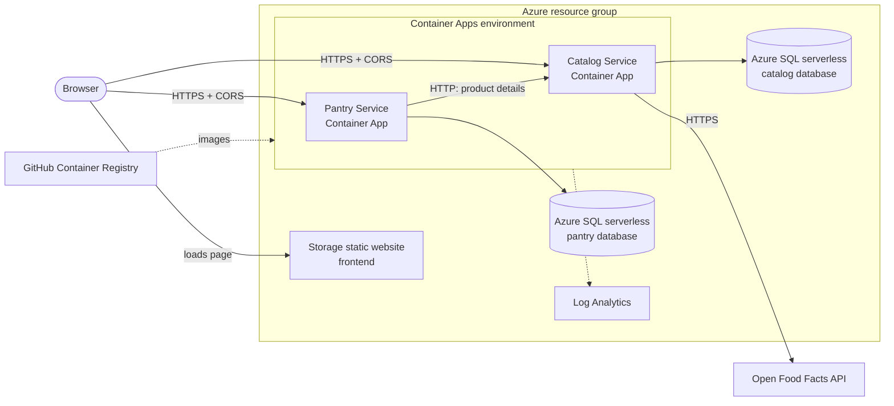

# PantryPal

PantryPal helps people keep track of the food they have at home and check a product before buying it. You enter a product barcode, PantryPal looks it up on [Open Food Facts](https://world.openfoodfacts.org), and you can save it to your pantry with a quantity or just check its Nutri-Score.

The full product scope, rules and out-of-scope list are in [docs/product-scope.md](docs/product-scope.md).

**Live URL:** https://sddbcsaig3bui1ffa64df.z1.web.core.windows.net (public frontend). The first successful automated deployment completed on 16 November 2026; merges to `main` deploy after CI passes.

## Features

| Feature | Status |
| --- | --- |
| Look up a product by barcode (name, brand, image, Nutri-Score) | Backend and browser UI deployed |
| Pantry: add, view, update quantity, delete | Deployed through PR #58. Phone and laptop acceptance for update and removal is pending in #45 |
| Restock list | Set a minimum per product and see how many units to buy, even when stock reaches zero |
| Check before you buy: look up without saving | Planned, Sprint 2 |
| Check Before You Buy | Lookup shows a coloured Nutri-Score badge or “Not available”. Choose a quantity and click “Add to pantry” to save the product, or “Cancel” to clear the lookup. |
| Camera barcode scanning | Use Scan on HTTPS or localhost. Type the barcode if camera access is unavailable |
| What can I cook? | Three sample recipes, each shown as "Ready" or with what is missing, from the pantry stock. Packages from different brands count together when their saved names match the ingredient or a supported alias |
| Camera barcode scanning | Use Scan on HTTPS or localhost, select Scan photo for a saved image, or type the barcode. If the bars cannot be read, the browser tries the printed digits and asks you to confirm before lookup. |
| What can I cook? | Three sample recipes, each shown as "Ready" or with what is missing, from the pantry stock |
| Pantry overview | Packages per Nutri-Score grade (A–E and "Not available") and the share graded A or B, from the pantry stock |
| Service health page | Running locally and on Azure |

Optional, only after the MVP works: expiry dates.

## Architecture

PantryPal has exactly two backend services, each with its own database, and a static frontend.

- **Pantry Service** (FastAPI) stores the user's pantry items and quantities. When a new barcode is added, it asks the Catalog Service for the product details over HTTP and stores a snapshot of them, so existing pantry items keep working if the Catalog Service is down.
- **Catalog Service** (FastAPI) looks products up on Open Food Facts and caches the results in its own database.
- **Frontend** is plain HTML, CSS and JavaScript. It runs in the browser and calls both services directly. Each service only accepts cross-origin requests from the frontend's origin (CORS).

Personal-account deployment on Azure (Sprint 1):



Locally, Docker Compose runs the same two services against two SQL Server containers. nginx serves the static frontend on port 8080 for local development only. While the team deploys to a personal Azure account instead of the group's institution account, the frontend is hosted as an Azure Storage static website. Static Web Apps isn't available in the regions that subscription allows, and the team was asked to use Storage hosting for the time being.

| Component | Local URL | Azure |
| --- | --- | --- |
| Frontend | http://localhost:8080 | Storage static website |
| Pantry Service | http://localhost:8000 | Container App (Sprint 1) |
| Catalog Service | http://localhost:8001 | Container App (Sprint 1) |
| Pantry database | localhost:1433 (SQL Server 2022) | Azure SQL serverless |
| Catalog database | localhost:1434 (SQL Server 2022) | Azure SQL serverless |

Each service exposes `GET /health` and writes one log line per request to stdout:

```
INFO method=GET path=/health status=200 duration_ms=2
```

## Repository structure

```
pantrypal-devops/
├── pantry-service/      FastAPI service: pantry items (app/, tests/, Dockerfile)
├── catalog-service/     FastAPI service: product lookup and cache (app/, tests/, Dockerfile)
├── frontend/            Static UI: index.html, styles.css, app.js, config.js
├── db/                  create-app-login.sh, creates each service's own SQL login locally
├── infra/               setup.sh and create-db-users.sh, the Azure setup scripts
├── docs/                Product scope, Scrum documents
├── docker-compose.yml   Local stack
└── .env.example         Template for the local .env file
```

## Run locally

Requirements: Docker with Docker Compose v2. On Windows, use Docker Desktop with WSL integration enabled for your distro.

1. Clone the repository and create your `.env` file:

   ```bash
   git clone https://github.com/matheusfunabashi/pantrypal-devops.git
   cd pantrypal-devops
   cp .env.example .env
   ```

2. Fill in the four passwords in `.env`. SQL Server rejects weak passwords, so each one needs at least 8 characters with upper case, lower case, a digit and a symbol. `.env.example` shows a command that generates one. Use four different passwords.

3. Start the stack:

   ```bash
   docker compose up --build -d
   ```

   The first start takes a minute or two while SQL Server initialises. The `pantry-db-init` and `catalog-db-init` jobs create each service's own database login and then exit with code 0. The APIs start after that.

4. Check that it works:

   ```bash
   docker compose ps -a          # both *-db-init jobs: Exited (0); everything else: Up
   curl http://localhost:8000/health   # {"status":"ok","service":"pantry"}
   curl http://localhost:8001/health   # {"status":"ok","service":"catalog"}
   ```

   Open http://localhost:8080. Both services should show as **Healthy**.

5. Stop the stack:

   ```bash
   docker compose down        # keeps the database volumes
   docker compose down -v     # also deletes the local databases
   ```

### Troubleshooting

- **`error mounting ... /scripts/create-app-login.sh ... no such file or directory`.** This happens when `db/create-app-login.sh` changed on disk (for example after a pull or a branch switch) and Compose reuses the old init containers. Recreate them:

  ```bash
  docker compose up --build -d --force-recreate
  ```

- **You can't save files in `frontend/`.** If `docker compose up` ran before `frontend/` existed, Docker created the folder as `root`. Give it back to your user:

  ```bash
  sudo chown -R "$USER":"$USER" frontend
  ```

- **The page shows a service as Unavailable.** Check `docker compose ps -a` and `docker compose logs pantry-service catalog-service`. A `*-db-init` job that exited with a non-zero code usually means a password in `.env` doesn't meet SQL Server's rules.

## Run the tests

Each service has its own tests. From the repository root, with Python 3.12:

```bash
cd pantry-service
python -m venv .venv
source .venv/bin/activate        # Windows PowerShell: .venv\Scripts\Activate.ps1
pip install -r requirements-dev.txt
python -m pytest
deactivate
```

Repeat in `catalog-service/`. Without a local Python, you can run the tests in the same image the service uses:

```bash
docker run --rm -v "$PWD/pantry-service:/app" -w /app python:3.12.16-slim-bookworm \
  sh -c "pip install -q -r requirements-dev.txt && python -m pytest -p no:cacheprovider"
```

Linting, formatting, dependency auditing and the coverage threshold run in GitHub Actions.

## Azure setup

Sprint 1 uses @Thecoolss's personal Azure subscription, with a dedicated project
resource group and a GitHub deployment identity scoped to that group.

Follow [the personal Azure setup runbook](docs/azure-personal-setup.md) for naming,
resource creation, database users, GitHub secrets and variables, deployment,
verification, and password rotation. It accounts for existing unrelated projects.

The professor advised group 8 to continue on the personal deployment while IE prepares the group GitHub identity. The pipeline deployed both services and the Storage frontend from main commit `724ee2e`. Health checks passed. The optional feature smoke job was disabled. [CD run](https://github.com/matheusfunabashi/pantrypal-devops/actions/runs/44541649429)

The prepared Group 8 deployment uses two Container Apps, Azure SQL and a Free Static Web App in `rg-sdd-3b-g8`. The personal site above is still live until the group workflow deploys and passes the public checks. [Group 8 Azure setup and verification](docs/azure-group-setup.md)

## Documentation

- [Product scope](docs/product-scope.md)
- [Definition of Done](docs/scrum/definition-of-done.md)
- [AI usage](AI_USAGE.md)
- [Decision records](docs/decisions.md)
- [Personal Azure setup runbook](docs/azure-personal-setup.md)
- Sprint records are in `docs/scrum/`. The [data model](docs/data-model.md) describes both service databases.

## Team

| GitHub | Main area |
| --- | --- |
| [@Thecoolss](https://github.com/Thecoolss) | Sprint 1 Scrum Master; Azure, CD and frontend deployment |
| [@matheusfunabashi](https://github.com/matheusfunabashi) | Pantry Service and UI, Docker Compose, repository settings |
| [@gustaveems](https://github.com/gustaveems) | Sprint 1 Product Owner; Catalog Service, lookup UI and CI |

Product Owner and Scrum Master rotate each sprint. Who held each role is recorded in `docs/scrum/sprint-N.md`.

On 19 November the team enabled the personal deployment smoke job in GitHub. Direct checks of the deployed barcode lookup and pantry list both returned HTTP 200. The next full main deployment will provide the first Actions result with the flag enabled.
