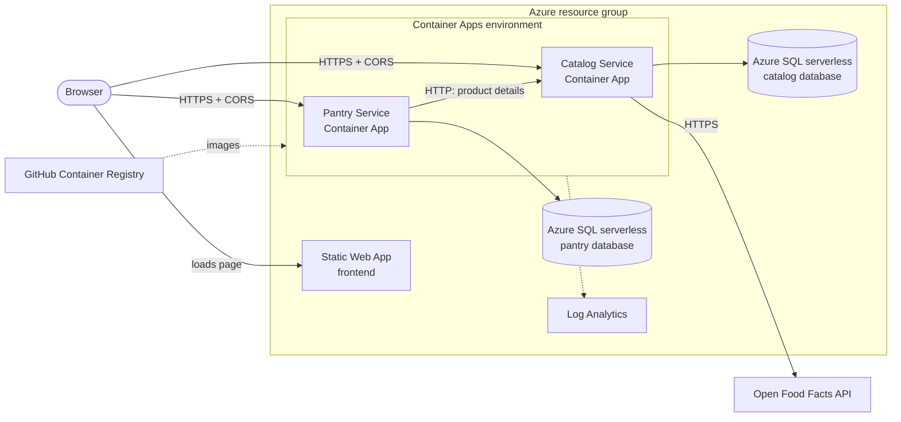

# PantryPal

PantryPal helps people keep track of the food they have at home and check a product before buying it. You enter a product barcode, PantryPal looks it up on [Open Food Facts](https://world.openfoodfacts.org), and you can save it to your pantry with a quantity or just check its Nutri-Score.

The full product scope, rules and out-of-scope list are in [docs/product-scope.md](docs/product-scope.md).

**Live URL:** not deployed yet. The first Azure deployment is planned for Sprint 1 (11–18 November 2026).

## Features

| Feature | Status |
| --- | --- |
| Look up a product by barcode (name, brand, image, Nutri-Score) | Planned, Sprint 1 |
| Pantry: add, view, update quantity, delete | Planned, Sprint 1 |
| Check before you buy: look up without saving | Planned, Sprint 2 |
| Service health page | Done (local) |

Optional, only after the MVP works: camera barcode scanning, expiry dates, running-low view.

## Architecture

PantryPal has exactly two backend services, each with its own database, and a static frontend.

- **Pantry Service** (FastAPI) stores the user's pantry items and quantities. When a new barcode is added, it asks the Catalog Service for the product details over HTTP and stores a snapshot of them, so existing pantry items keep working if the Catalog Service is down.
- **Catalog Service** (FastAPI) looks products up on Open Food Facts and caches the results in its own database.
- **Frontend** is plain HTML, CSS and JavaScript. It runs in the browser and calls both services directly. Each service only accepts cross-origin requests from the frontend's origin (CORS).

Target deployment on Azure (Sprint 1):



Locally, Docker Compose runs the same two services against two SQL Server containers. nginx serves the static frontend on port 8080 for local development only. In Azure the frontend is hosted on Static Web Apps.

| Component | Local URL | Azure |
| --- | --- | --- |
| Frontend | http://localhost:8080 | Static Web App (Sprint 1) |
| Pantry Service | http://localhost:8000 | Container App (Sprint 1) |
| Catalog Service | http://localhost:8001 | Container App (Sprint 1) |
| Pantry database | localhost:1433 (SQL Server 2022) | Azure SQL serverless |
| Catalog database | localhost:1434 (SQL Server 2022) | Azure SQL serverless |

Each service exposes `GET /health` and writes one log line per request to stdout:

```
INFO method=GET path=/health status=200 duration_ms=2
```

## Repository structure

```
pantrypal-devops/
├── pantry-service/      FastAPI service: pantry items (app/, tests/, Dockerfile)
├── catalog-service/     FastAPI service: product lookup and cache (app/, tests/, Dockerfile)
├── frontend/            Static UI: index.html, styles.css, app.js, config.js
├── db/                  create-app-login.sh, creates each service's own SQL login locally
├── docs/                Product scope, Scrum documents
├── docker-compose.yml   Local stack
└── .env.example         Template for the local .env file
```

## Run locally

Requirements: Docker with Docker Compose v2. On Windows, use Docker Desktop with WSL integration enabled for your distro.

1. Clone the repository and create your `.env` file:

   ```bash
   git clone https://github.com/matheusfunabashi/pantrypal-devops.git
   cd pantrypal-devops
   cp .env.example .env
   ```

2. Fill in the four passwords in `.env`. SQL Server rejects weak passwords, so each one needs at least 8 characters with upper case, lower case, a digit and a symbol. `.env.example` shows a command that generates one. Use four different passwords.

3. Start the stack:

   ```bash
   docker compose up --build -d
   ```

   The first start takes a minute or two while SQL Server initialises. The `pantry-db-init` and `catalog-db-init` jobs create each service's own database login and then exit with code 0. The APIs start after that.

4. Check that it works:

   ```bash
   docker compose ps -a          # both *-db-init jobs: Exited (0); everything else: Up
   curl http://localhost:8000/health   # {"status":"ok","service":"pantry"}
   curl http://localhost:8001/health   # {"status":"ok","service":"catalog"}
   ```

   Open http://localhost:8080. Both services should show as **Healthy**.

5. Stop the stack:

   ```bash
   docker compose down        # keeps the database volumes
   docker compose down -v     # also deletes the local databases
   ```

### Troubleshooting

- **`error mounting ... /scripts/create-app-login.sh ... no such file or directory`.** This happens when `db/create-app-login.sh` changed on disk (for example after a pull or a branch switch) and Compose reuses the old init containers. Recreate them:

  ```bash
  docker compose up --build -d --force-recreate
  ```

- **You can't save files in `frontend/`.** If `docker compose up` ran before `frontend/` existed, Docker created the folder as `root`. Give it back to your user:

  ```bash
  sudo chown -R "$USER":"$USER" frontend
  ```

- **The page shows a service as Unavailable.** Check `docker compose ps -a` and `docker compose logs pantry-service catalog-service`. A `*-db-init` job that exited with a non-zero code usually means a password in `.env` doesn't meet SQL Server's rules.

## Run the tests

Each service has its own tests. From the repository root, with Python 3.12:

```bash
cd pantry-service
python -m venv .venv
source .venv/bin/activate        # Windows PowerShell: .venv\Scripts\Activate.ps1
pip install -r requirements.txt
python -m pytest
deactivate
```

Repeat in `catalog-service/`. Without a local Python, you can run the tests in the same image the service uses:

```bash
docker run --rm -v "$PWD/pantry-service:/app" -w /app python:3.12.16-slim-bookworm \
  sh -c "pip install -q -r requirements.txt && python -m pytest -p no:cacheprovider"
```

Linting, formatting and the coverage threshold will run in GitHub Actions from Sprint 1.

## Azure setup

Planned for Sprint 1. The setup will be scripted or written as infrastructure as code in this repository, so it can be reproduced without manual portal changes. All resources go in the group's existing resource group and use the group prefix:

- 2 Azure Container Apps on the Consumption plan, scaling to zero, maximum 1 replica
- 2 serverless Azure SQL databases with auto-pause
- 1 Azure Static Web App for the frontend
- Container images in GitHub Container Registry, tagged with the commit SHA
- Logs in the Log Analytics workspace of the Container Apps environment

This section will document the exact commands once the setup exists.

## Documentation

- [Product scope](docs/product-scope.md)
- [Definition of Done](docs/scrum/definition-of-done.md)
- [AI usage](AI_USAGE.md)
- Sprint records, decision records (`docs/decisions.md`) and the data model (`docs/data-model.md`) will be added as the project progresses.

## Team

| GitHub | Main area |
| --- | --- |
| [@Thecoolss](https://github.com/Thecoolss) | Product, frontend, Pantry Service |
| [@matheusfunabashi](https://github.com/matheusfunabashi) | Repository, Docker Compose, Azure and CI/CD |
| [@gustaveems](https://github.com/gustaveems) | Backend services, Catalog Service, monitoring |

Product Owner and Scrum Master rotate each sprint. Who held each role is recorded in `docs/scrum/sprint-N.md`.
