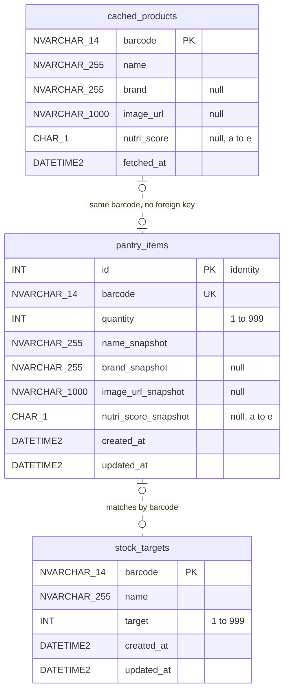

# Data model

PantryPal has two databases, one per service. They are never joined: the only thing they share is the barcode, a string of 8 to 14 digits. Barcodes are stored as text so leading zeros are kept.

The dotted lines show barcode matches. Catalog and Pantry use separate databases. Within Pantry, a stock target can survive deletion of the matching inventory row.

## catalog_db: `cached_products`

Owned by the Catalog Service. One row per product fetched from Open Food Facts. Created by migration `0001_create_cached_products`.

| Column | Type | Null | Notes |
| --- | --- | --- | --- |
| `barcode` | NVARCHAR(14) | no | Primary key |
| `name` | NVARCHAR(255) | no | Trimmed. "Unknown product" if Open Food Facts has no name |
| `brand` | NVARCHAR(255) | yes | The first brand from Open Food Facts' `brands` |
| `image_url` | NVARCHAR(1000) | yes | `image_front_small_url` |
| `nutri_score` | CHAR(1) | yes | Check constraint: `a` to `e` only. Unknown or not-applicable grades are stored as null, never guessed |
| `fetched_at` | DATETIME2 | no | Naive UTC time of the last fetch. Drives the cache rule |

**Cache rule.** If `fetched_at` is younger than `CACHE_TTL_DAYS` (default 7), the row is returned with `source: cache` and Open Food Facts is not called. An older row is refreshed and its row updated in place. If Open Food Facts is unavailable and a row exists, the stale row is returned. Unknown barcodes are not stored.

## pantry_db: `pantry_items`

Owned by the Pantry Service. One row per distinct barcode in the user's pantry. Created by migration `0001_create_pantry_items`.

| Column | Type | Null | Notes |
| --- | --- | --- | --- |
| `id` | INT, identity | no | Primary key |
| `barcode` | NVARCHAR(14) | no | Unique (`uq_pantry_items_barcode`). Adding an existing barcode increases its quantity instead of adding a row |
| `quantity` | INT | no | Check constraint: 1 to 999 |
| `name_snapshot` | NVARCHAR(255) | no | Copied from the Catalog Service when the item is first added |
| `brand_snapshot` | NVARCHAR(255) | yes | Same |
| `image_url_snapshot` | NVARCHAR(1000) | yes | Same |
| `nutri_score_snapshot` | CHAR(1) | yes | Same. Check constraint: `a` to `e` only |
| `created_at` | DATETIME2 | no | UTC. Defaults to the time of insert |
| `updated_at` | DATETIME2 | no | UTC. Set on insert and whenever the quantity changes |

**Snapshots.** The product fields are copied into the pantry row so that listing, updating and deleting items does not need the Catalog Service. They are not refreshed later: they show the product as it was when it was added.

## Pantry stock targets and recipes

Migration `0002_create_stock_targets` adds `stock_targets` to the Pantry database. Each row stores a barcode as primary key, the product name, a target of 1–999 packages, and UTC creation and update timestamps. All five columns are required. Creating a target requires an existing pantry item. There is no foreign key to `pantry_items`, so deleting the last pack preserves the minimum until the user clears it.

The restock list shows a product when its target exceeds its current quantity. A missing inventory row counts as zero. Recipes are defined in `pantry-service/app/recipe_data.py`; the API calculates availability from current pantry quantities on each request.

## Migrations

Both services use Alembic, with the migrations in `migrations/versions/`. A container runs `alembic upgrade head` when it starts, retrying while the database is unreachable (for example while a serverless Azure SQL database resumes), then starts the API. To change a table, add a new migration and update the model and this file in the same pull request.

See ADR-1 and ADR-2 in [decisions.md](decisions.md) for why the data is split this way.
